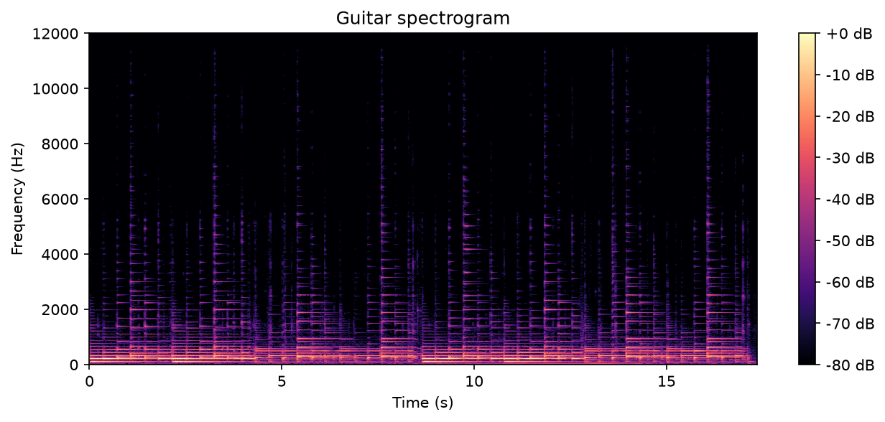
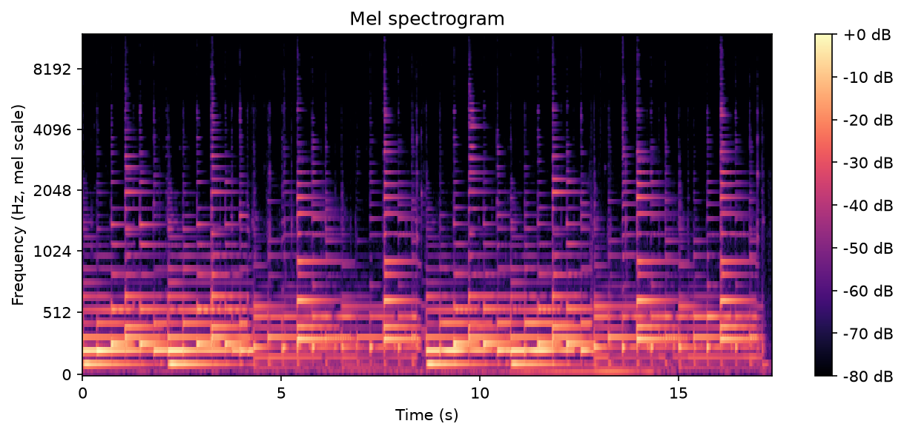

<p class="pd-kicker">03 · Cómo se detecta</p>

# Espectrogramas: el audio como imagen

Antes de detectar nada, lo primero que tenemos que resolver es cómo hacemos que un modelo
*entienda* el sonido.

Sabemos que ha habido un montón de avances en visión por computadora, así que una buena idea es
convertir el audio en una imagen. La representación más común se llama **espectrograma**: una
especie de huella digital del sonido, donde el eje horizontal es el tiempo, el eje vertical es la
frecuencia (de graves abajo a agudos arriba) y el color indica qué tan fuerte suena cada cosa.

En Python tenemos varias librerías que nos ayudan. Aquí usamos
[librosa](https://librosa.org/). El script completo está en
[`examples/01_spectrograms.py`](https://github.com/fergarciadlc/pyday26-ai-music-detection/blob/main/examples/01_spectrograms.py).

## Un audio es una lista de números

```python
--8<-- "examples/01_spectrograms.py:load"
```

```text
416,689 muestras a 24,000 Hz = 17.4 segundos
[-0.00047228 -0.00105318 -0.00122118 -0.00119762 -0.00121236]
```

## De números a imagen

La transformada de Fourier de tiempo corto (STFT) corta el audio en ventanitas y nos dice qué
frecuencias suenan en cada una.

```python
--8<-- "examples/01_spectrograms.py:stft"
```

## A dibujarlo

```python
--8<-- "examples/01_spectrograms.py:plot"
```

{ .pd-figure }

Cada nota de la guitarra aparece como una columna de líneas horizontales: la más baja es la nota
que tocamos y las de arriba son sus armónicos.

## Una variante: el espectrograma mel

Nuestro oído distingue mucho mejor las diferencias entre graves que entre agudos. La escala mel
imita eso, y muchos modelos de audio la usan.

```python
--8<-- "examples/01_spectrograms.py:mel"
```

{ .pd-figure }

!!! note "¿Por qué el detector usa el espectrograma lineal?"
    La escala mel junta los agudos en pocas bandas, y es justo ahí, en detalles finos y en
    frecuencias fijas, donde quedan las marcas del decoder. Por eso para detectar usamos el
    espectrograma lineal de la STFT.

Con el audio convertido en imagen, detectar música generada por IA se vuelve un problema de
**visión por computadora**.

[Siguiente: un detector en PyTorch :material-arrow-right:](detector.md){ .md-button .md-button--primary }
