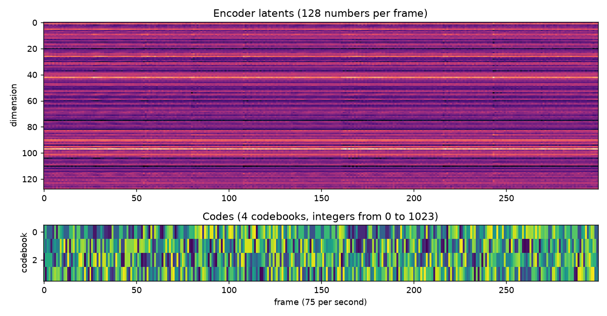

<p class="pd-kicker">02 · Cómo se genera música con IA</p>

# Un codec neuronal por dentro

Para entender cómo se detecta la música generada por IA, primero hay que darnos una idea de
cómo se genera.

Muchos de los modelos generativos actuales funcionan alrededor de un **codec neuronal**. Se
parece mucho a cómo funciona un MP3, pero con redes neuronales. Un audio está formado por un
montón de números; el **encoder** lo comprime en muchísimos menos números, que vamos a llamar
**latentes**. Luego el **decoder** toma esos latentes y los regresa a algo muy parecido al
audio original. A esto se le conoce como *autoencoder*.

Y está muy bien, pero ¿de qué nos sirve comprimir y descomprimir un audio? Pues muchos modelos
generativos se entrenan para generar **solamente los latentes**, la parte comprimida. El
encoder se retira por completo: el modelo generativo (que puede tener muchas arquitecturas
distintas) inventa latentes nuevos, y el decoder los convierte en un audio completamente nuevo.

Aquí viene algo muy importante: no importa la arquitectura, **al final todo pasa por un
decoder**. Y el decoder deja pequeñas marcas en el audio. Esto va a tener mucho sentido cuando
hablemos de detección.

Vamos a abrir un codec con Python y ver todo esto con nuestros propios ojos (y oídos). Usaremos
[EnCodec](https://huggingface.co/facebook/encodec_24khz), el codec de Meta que usan modelos como
MusicGen, y una grabación mía de guitarra. El script completo está en
[`examples/02_codec_latents.py`](https://github.com/fergarciadlc/pyday26-ai-music-detection/blob/main/examples/02_codec_latents.py).

## 1. Cargar el codec y el audio

```python
--8<-- "examples/02_codec_latents.py:load"
```

<div class="pd-exps">
  <div class="pd-exp">
    <p class="pd-exp-title">La grabación original</p>
    <audio controls preload="none" src="../assets/examples/02/original.mp3"></audio>
  </div>
</div>

## 2. El encoder: de audio a latentes

```python
--8<-- "examples/02_codec_latents.py:encoder"
```

Los 416,689 números del audio se convirtieron en una "imagen" de 128 × 1,303. Cada columna
describe unos 13 milisegundos de sonido.

## 3. Los códigos: comprimir todavía más

Para guardar o transmitir el audio, EnCodec da un paso más: cambia cada columna de latentes
por unos pocos números enteros, como si buscara la palabra más parecida en un diccionario.

```python
--8<-- "examples/02_codec_latents.py:codes"
```

{ .pd-figure }

## 4. El decoder: de vuelta al audio

```python
--8<-- "examples/02_codec_latents.py:decoder"
```

<div class="pd-exps">
  <div class="pd-exp">
    <p class="pd-exp-title">Original</p>
    <audio controls preload="none" src="../assets/examples/02/original.mp3"></audio>
  </div>
  <div class="pd-exp">
    <p class="pd-exp-title">Reconstruida desde los códigos</p>
    <audio controls preload="none" src="../assets/examples/02/reconstruction.mp3"></audio>
    <p>Un archivo 128 veces más pequeño y suena casi igual.</p>
  </div>
</div>

## 5. ¿Y si le movemos a los latentes?

Ahora lo divertido: modificamos los latentes antes de pasarlos por el decoder.

```python
--8<-- "examples/02_codec_latents.py:modify"
```

<div class="pd-exps">
  <div class="pd-exp">
    <p class="pd-exp-title">Un poco de ruido</p>
    <audio controls preload="none" src="../assets/examples/02/noise_small.mp3"></audio>
    <p>Sigue siendo la guitarra, un poco más brillante. El decoder aguanta cambios pequeños.</p>
  </div>
  <div class="pd-exp">
    <p class="pd-exp-title">Mucho ruido</p>
    <audio controls preload="none" src="../assets/examples/02/noise_large.mp3"></audio>
    <p>La guitarra se pierde casi por completo.</p>
  </div>
  <div class="pd-exp">
    <p class="pd-exp-title">Al revés</p>
    <audio controls preload="none" src="../assets/examples/02/reversed.mp3"></audio>
    <p>Los mismos latentes en orden inverso. Ojo: no es lo mismo que poner el audio en reversa.</p>
  </div>
  <div class="pd-exp">
    <p class="pd-exp-title">Un instante congelado</p>
    <audio controls preload="none" src="../assets/examples/02/frozen.mp3"></audio>
    <p>Repetimos el frame del segundo 3 durante todo el audio: un sonido sostenido, sin ataques.</p>
  </div>
</div>

## 6. Latentes inventados

¿Y si en lugar de modificar latentes reales los inventamos? Al fin y al cabo, eso es lo que
hace un modelo generativo.

```python
--8<-- "examples/02_codec_latents.py:invent"
```

<div class="pd-exps">
  <div class="pd-exp">
    <p class="pd-exp-title">Latentes aleatorios</p>
    <audio controls preload="none" src="../assets/examples/02/random_latents.mp3"></audio>
    <p>Números al azar con la misma escala que los reales: suena a ruido.</p>
  </div>
  <div class="pd-exp">
    <p class="pd-exp-title">Códigos aleatorios</p>
    <audio controls preload="none" src="../assets/examples/02/random_codes.mp3"></audio>
    <p>Palabras al azar del diccionario: ruido entrecortado, sin nada de música.</p>
  </div>
  <div class="pd-exp">
    <p class="pd-exp-title">Todo en cero</p>
    <audio controls preload="none" src="../assets/examples/02/zeros.mp3"></audio>
    <p>Sin información, el decoder igual produce algo: un zumbido constante. Guárdalo en mente.</p>
  </div>
</div>

!!! tip "Por eso se entrenan modelos generativos"
    El decoder solo sabe convertir latentes en sonido; no sabe qué latentes suenan a música.
    Si le damos números al azar, nos regresa ruido. Lo difícil, y lo que aprende un modelo
    generativo como los de Suno o MusicGen, es **inventar latentes que tengan sentido**.
    Todos los audios de esta página están al mismo volumen para poder compararlos.

## 7. Todos traen la huella del decoder

En la [página de fakeprints](detecta/fakeprints.md) vemos que el decoder de EnCodec deja picos
en múltiplos de 600 Hz. Medimos esos picos en todo lo que acabamos de generar:

```python
--8<-- "examples/02_codec_latents.py:fingerprint"
```

| Audio | Picos en múltiplos de 600 Hz |
|---|---|
| Original (sin pasar por el codec) | +0.7 dB |
| Reconstruida | +4.8 dB |
| Un poco de ruido | +3.5 dB |
| Mucho ruido | +4.0 dB |
| Al revés | +3.2 dB |
| Un instante congelado | +15.0 dB |
| Latentes aleatorios | +2.6 dB |
| Códigos aleatorios | +0.6 dB |
| **Todo en cero** | **+31.5 dB** |

Casi todo lo que sale del decoder trae su huella, incluso cuando los latentes son ruido. Los
códigos aleatorios son la excepción: producen tanto ruido que tapan los picos. Y el caso más
interesante es el de los ceros: sin música que reconstruir, lo único que queda es el decoder,
y ese zumbido constante es **la huella sola**. Eso es justo lo que aprenden a reconocer los
detectores.

[Siguiente: espectrogramas :material-arrow-right:](detecta/espectrogramas.md){ .md-button .md-button--primary }
